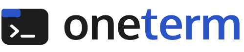
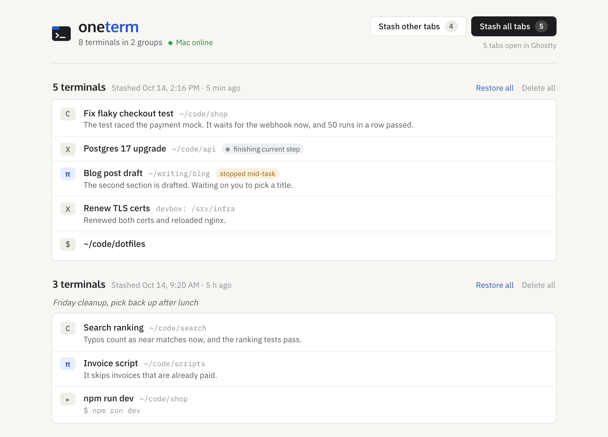

<p align="center">
  <picture>
    <source media="(prefers-color-scheme: dark)" srcset=".github/assets/logo-dark.svg">
    
  </picture>
</p>

<p align="center"><strong>OneTab for Ghostty.</strong></p>

oneterm saves your [Ghostty](https://ghostty.org) tabs to a list and closes them, including any [pi](https://pi.dev), [Claude Code](https://code.claude.com/docs/en/overview), or [Codex](https://developers.openai.com/codex/cli) sessions running in them. Then you can bring them back one at a time when you actually need them, instead of staring at 15 tabs. It works for sessions on other machines over SSH too.

I built this for my own setup and I'm sharing it as-is. It should work on your Mac with a little setup, but I'm not planning to support it, so fork it if you want it to work differently.

<p align="center">
  
</p>

## How it works

When you run `oneterm stash`, it asks Ghostty for every open tab through its [AppleScript interface](https://ghostty.org/docs/features/applescript) and checks what's running in each one. An idle shell gets saved as its working directory. A pi, Claude Code, or Codex session gets saved by its exact session ID, which the agent reports itself through a pi extension or lifecycle hooks. If a tab is SSHed into a host you've set up, oneterm looks at what's running on that host, so restoring it brings back the remote agent itself. Anything else, like an editor, a dev server, or an agent without the hooks, stays open, and oneterm tells you why.

It won't kill an agent in the middle of something. The tool call that's running gets to finish and its result is saved, any new tool calls get refused, and the agent stops before it talks to the model again. That session shows up as "stopped mid-task", so just say "continue" when you reopen it. If an agent can't get to a safe stopping point within two minutes, oneterm leaves its tab alone.

Restoring opens a new tab in the saved directory and runs `pi --session <file>`, `claude --resume <id>`, or `codex --no-daemon resume <id>`, over SSH if the session was remote. Terminals that shared a tab come back as splits.

If Ghostty goes away with tabs still open, because it crashed, you quit it, or the Mac restarted, oneterm saves those tabs for you. The LaunchAgent looks at your tabs every 15 seconds, and once the Ghostty that had them is gone, it puts what it last saw into a new group and sends a notification, so you don't have to remember which sessions were open. Ghostty's `window-save-state` already reopens plain shells in their folders, so oneterm leaves those out. Anything it can't resume, like an editor or a dev server, is saved as its command line, which gets typed in but not run when you restore it. Closing a tab or a window yourself doesn't save anything.

## Usage

```sh
oneterm stash              # every tab
oneterm stash --others     # every tab but the front one
oneterm stash --this       # only the front tab
oneterm stash --dry-run    # list what would close and what would stay open
oneterm restore            # fzf picker. Tab selects several, Ctrl-D deletes
oneterm ls
oneterm open               # the web page
```

In pi, `/oneterm all`, `/oneterm others`, and `/oneterm this` do the same thing.

There's also a [OneTab](https://www.one-tab.com)-style web page. A small hub on an always-on server serves it, so you can get to it from your phone or while your Mac is asleep. Click something to reopen it, drag things between groups, or delete them. To stash from the page, use "Stash all tabs", or "Choose tabs…" to pick which open Ghostty tabs go. If the Mac is offline, the hub holds onto your clicks and sends them once it's back. The hub only ever sends the Mac item IDs, so nothing typed into the page can make your Mac run a command.

Once you have more than 6 tabs open, you'll get a notification with a "Stash all tabs" button. You can change the limit with `tabCap` in `~/.oneterm/config.json`, or set it to 0 to turn the notification off. `nudgeRepeatMinutes` controls how often it reminds you.

## Setup

You'll need macOS, Ghostty 1.3 or later, Node 22.18 or later, Python 3.9 or later, [fzf](https://github.com/junegunn/fzf#installation), and [terminal-notifier](https://github.com/julienXX/terminal-notifier). Clone the repo to `~/workspace/oneterm`, because the pi extension, the LaunchAgent, and the [Raycast scripts](https://github.com/raycast/script-commands) all expect it there.

```sh
ln -s ~/workspace/oneterm/bin/oneterm ~/.local/bin/oneterm
pi install ~/workspace/oneterm                 # pi extension
python3 support/agents.py --install            # Claude Code and Codex hooks
sed -e "s|__ONETERM__|$PWD|g" -e "s|__HOME__|$HOME|g" launchd/com.colin.oneterm-agent.plist \
  > ~/Library/LaunchAgents/com.colin.oneterm-agent.plist
launchctl bootstrap gui/$(id -u) ~/Library/LaunchAgents/com.colin.oneterm-agent.plist
cp raycast/*.sh ~/raycast/script-commands/     # optional Raycast commands
```

The hook installer adds the [Claude Code hooks](https://code.claude.com/docs/en/hooks) and [Codex hooks](https://developers.openai.com/codex/hooks) to your existing `~/.claude/settings.json` and `~/.codex/hooks.json`, and it backs both files up to `~/.oneterm/backups/` first. Codex will ask you to trust the new hooks once in `/hooks`. Codex also has to run with `--no-daemon`, because its shared background server makes it impossible to tell which terminal a session belongs to. The easiest fix is a shell wrapper that adds the flag to interactive `codex` calls.

For remote sessions, copy `support/agents.py` to `~/.oneterm/agents.py` on the server and run it there with `--install`. Then add the host to `remoteHosts` in `~/.oneterm/config.json` on your Mac. For pi on the server, also copy `extension/oneterm.ts` to `~/.pi/agent/extensions/` there. The server can run Linux or macOS. Right now oneterm only matches plain `ssh [-t] [-p PORT] [-l USER] [-i KEY] HOST` connections, and each login needs its own connection, so turn off `ControlMaster` for that host. If you want to keep it for scripts, `Match originalhost HOST exec "test -t 2"` with `ControlPath none` turns it off only for logins at a terminal.

The hub is optional. Without `~/.oneterm/hub.json`, the LaunchAgent still saves tabs when Ghostty closes and still nudges, and you use the CLI instead of the page. The hub runs in Docker, and `./deploy-hub.sh HOST` copies it to your server over ssh and starts it. Make a random token and put it in `~/.oneterm/hub.json` on your Mac as `{"url": "...", "token": "..."}`. On the server, `~/docker/oneterm/.env` needs that same token as `ONETERM_TOKEN`, plus `ONETERM_HOSTS`, which lists every `host:port` you'll open the page with, separated by commas.

The page itself has no login. Anyone who can reach the hub can see your stash and stash or reopen your tabs, so only run it somewhere private, like your LAN or a [Tailscale](https://tailscale.com) network. Don't put it on the public internet.

Agents you started before setting this up won't have the hooks yet, so restart them, or run `/reload-all` in pi.

## Development

`src/` has the CLI, the Mac agent, and the hub. `support/agents.py` is the hook handler, and it's also the helper that runs on SSH hosts. `extension/` is the pi extension, and `web/` is the page. State lives in `~/.oneterm`, or `$ONETERM_HOME` if you set it. `stash.json` is the list, `open.json` is the agent's record of what's running in Ghostty right now, and `history.jsonl` logs every stash, restore, and delete.

Run `npm test` for the tests. For live testing, point `ONETERM_HOME` at a scratch directory and pass `--tabs` with the IDs of throwaway tabs, so you don't stash your real ones.
